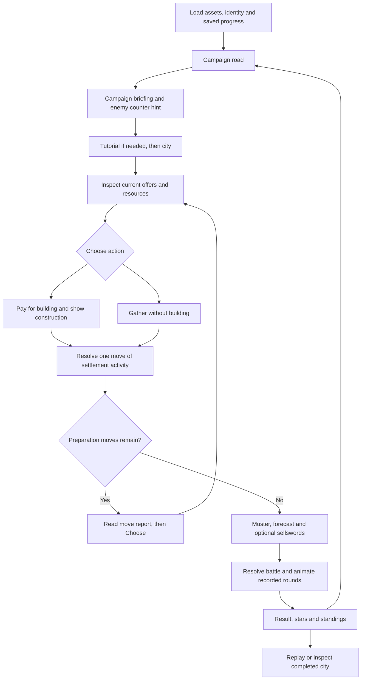
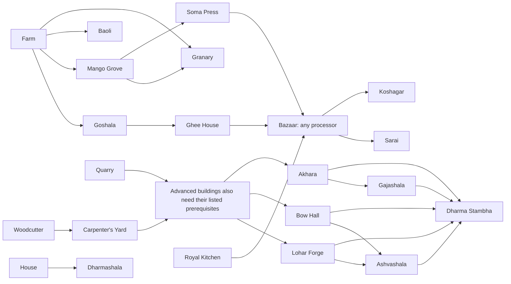

# Grow an Empire: complete game design and the GROW framework

**Document version:** 1.0  
**Date:** 22 October 2026  
**Implementation baseline:** Grow an Empire 0.13.0  
**Purpose:** a complete design reference for this game and a worked example for future GROW games.  
**Companion:** [Reusable GROW game design template](GROW_GAME_TEMPLATE.md).

> A GROW game gives the player a set of choices on every move. Each choice changes a growing world and the possibilities of later moves. When the campaign's move budget ends, a final challenge tests the consequences of those choices. The campaign is won by preparing the right combination, sequence and timing for that challenge.

This definition is the series foundation. Cities, armies, resources, three-card trays and stars are particular design choices made by Grow an Empire; future GROW games can express the same foundation through other settings and systems.

## Contents

1. [Design identity and scope](#1-design-identity-and-scope)
2. [The reusable GROW design contract](#2-the-reusable-grow-design-contract)
3. [Player experience and campaign flow](#3-player-experience-and-campaign-flow)
4. [Moves, choices and offers](#4-moves-choices-and-offers)
5. [Economy and population](#5-economy-and-population)
6. [Complete building catalog](#6-complete-building-catalog)
7. [Armies, the muster and the final battle](#7-armies-the-muster-and-the-final-battle)
8. [Campaign road, difficulty and rewards](#8-campaign-road-difficulty-and-rewards)
9. [The AI Realm and player leaderboard](#9-the-ai-realm-and-player-leaderboard)
10. [Interface, onboarding and accessibility](#10-interface-onboarding-and-accessibility)
11. [World, art, animation and sound](#11-world-art-animation-and-sound)
12. [Persistence and portal integration](#12-persistence-and-portal-integration)
13. [Architecture and content production](#13-architecture-and-content-production)
14. [Balance, analytics and validation](#14-balance-analytics-and-validation)
15. [Production, release and future design decisions](#15-production-release-and-future-design-decisions)
16. [Source map and maintenance](#16-source-map-and-maintenance)

## 1. Design identity and scope

### 1.1 The game in one paragraph

Grow an Empire is a short-session, single-player strategy game set in mythic Bharatvarsha. Starting from a founding campsite, the player spends a limited number of moves choosing buildings or gathering. The settlement automatically produces goods, processes food and materials, grows its population and trains an army after each completed move. At the end of the preparation budget, the player musters the army, optionally hires sellswords through the Bazaar, and faces the campaign's enemy. Victory earns stars, opens the road onward and improves standings in a separate field of AI rajas. The city is a visible record of the player's decisions.

### 1.2 Product identity

| Aspect | Current design |
|---|---|
| Genre | Choice-driven city builder, preparation strategy and sequencing puzzle |
| Player role | An exiled ruler founding settlements and preparing defenders along a campaign road |
| Core verbs | Inspect, choose, build, gather, read consequences, prepare, fight, compare and replay |
| Primary skill | Understanding dependencies, opportunity cost, compounding production and enemy counters |
| Campaign structure | 25 campaigns in five chapters; each attempt starts a new settlement |
| Preparation length | 12–25 moves on the current road; the rules support configured limits of 8–25 |
| Content pool | 24 unique buildable buildings; the civic center develops automatically |
| Progression | Best stars, campaign unlocks, AI Realm standing and a distinct weekly real-player leaderboard |
| Presentation | Painted isometric settlement, growing roads, working citizens and a popup battle |
| Platform | Browser game inside a Hippo Arcade portal iframe; responsive desktop and mobile layouts |
| Technology | Three.js, TypeScript, DOM/CSS interface, Web Audio and SDK v2 |
| Commercial boundary | No in-game purchases, purchasable resources or in-game access gate; portal access is handled by the host |

### 1.3 Player promise

“My choices build something I can see. I understand why it became strong or weak. I can try a different sequence and do better.”

The primary emotional sequence is curiosity → commitment → anticipation → visible growth → pressure from the remaining move budget → a decisive finale → understanding and renewed experimentation.

### 1.4 Design pillars

- **Consequences compound.** Early infrastructure earns repeated benefits; late infrastructure has fewer moves to repay its cost.
- **The world explains the system.** Producers, workshops, citizens and soldiers make the dependency chain visible.
- **The player directs; the settlement operates.** The player chooses investments, while production and recruitment resolve automatically.
- **The finale tests preparation.** Combat outcome follows the settlement's accumulated state, not a hidden reflex test.
- **Failure teaches.** Reports and result explanations connect a loss to a concrete shortage, counter or timing decision.
- **A run is finite.** The campaign's move limit provides urgency without requiring the player to make decisions against a real-time clock.
- **Recovery preserves experimentation.** Gather and camp supplies prevent economic dead ends; they do not guarantee victory against stronger campaigns.

### 1.5 Audience and limits

The intended audience enjoys compact strategy, visible progression and trying alternative solutions without operating a large management simulation. Planning is more important than dexterity. The presentation uses mild, non-graphic fantasy combat.

The current game does not include free-placement city planning, continuous idle production, multiplayer battles, controllable battlefield units, heroes with equipment, purchased upgrades or a persistent army carried from one campaign into the next. The AI Realm is simulated competition, not asynchronous PvP. These are scope boundaries, not missing requirements for every GROW game.

## 2. The reusable GROW design contract

### 2.1 Required qualities of a future GROW game

| Series requirement | What the player must experience | Empire example |
|---|---|---|
| A finite campaign | A known number of consequential moves before evaluation | The enemy arrives after `campaign.moveLimit` moves |
| A choice set each move | A meaningful decision among legal alternatives | Rolling building offers plus Gather |
| Accumulating state | Earlier decisions continue to matter | Buildings age, production repeats, army totals accumulate |
| Dependencies and interactions | Choices affect the value or availability of other choices | Farm opens food branches; workshops enable trainers |
| Visible growth | The world changes as decisions resolve | Construction, civic growth, roads, workers and formations |
| A final challenge | A clear pass/fail test of the prepared state | Deterministic battle against a specified army |
| A causal result | The player can connect success or failure to preparation | Strength forecast, stars, ledger and additional-unit hint |
| A learning loop | Replay offers a credible route to improvement | Choose a different build order, Gather timing or army mix |

“Right choices” means a sequence that satisfies the final challenge under its constraints. It need not mean one secret ordering. Multiple viable strategies should be an explicit design goal wherever the content supports them. A tutorial campaign may deliberately accept many weak sequences while later campaigns demand more preparation.

### 2.2 Formal model

Let `S(0)` be the founding state. Index committed moves by `t = 0 ... N-1` (the player sees move `t+1`). Let `O(t)` be the offered choices, `a(t)` the selected legal action and `N` the campaign move budget:

```text
O(t)     = Offer(S(t), campaign, t)
S(t+1)   = Resolve(S(t), a(t), campaign)
Outcome  = FinalChallenge(S(N), campaign)
Reward   = EvaluateQuality(Outcome, S(N), campaign)
```

The transition includes costs, completion effects, aging and all automatic systems in a declared order. Future games should specify this order before balancing. A visual animation explains the transition; it must not silently introduce a different result.

### 2.3 What is fixed and what is variable

The framework requires choices, a finite horizon, accumulating consequences and a final challenge. Each title chooses its setting, resource model, offer count, growth rules, optional recovery action, difficulty plan and final evaluator. Combat, three cards, 25 campaigns, nine resources, a medieval setting and a leaderboard are not mandatory series rules.

Illustrative future concepts—not features implemented here:

| Concept | Move choices | Growth and interaction | Final test |
|---|---|---|---|
| Grow a Forest | Plant species, retain water, restore soil, introduce habitat | Species mature and support or compete with one another | Survive a dry season with a functioning ecosystem |
| Grow a Colony | Add habitats, power, life support or research | Infrastructure capacity constrains population and production | Sustain a defined expedition or launch a vessel |
| Grow a Festival | Book performers, build facilities, train staff or promote | Audience, capacity, staffing and timing interact | Deliver the final event to a clear service and quality target |

A new title must change the strategic relationships and final test meaningfully; replacing building names while retaining every dependency is only a reskin.

### 2.4 Design questions every title must answer

What is growing? What does one move represent? What is consumed by choosing? Why does order matter? What improves with age? What can the player see before committing? Can an unaffordable or empty choice set occur? What can the player do then? How does the final challenge use the prepared state? What makes a replay informative?

The companion template turns these questions into a fill-in production document.

## 3. Player experience and campaign flow

### 3.1 Complete journey



### 3.2 Information before commitment

The briefing names the enemy, displays its composition, states the preparation limit and offers a counter hint. Building cards expose cost and permanent benefit, while extra unlock information is available through an info interaction. The resource dropdown exposes the stockpile, population, army and civic state. The player is not expected to discover an unknowable enemy only after investing the whole campaign.

### 3.3 Timing and pace

Construction lasts 30 simulation seconds. Available speeds are 1×, 2×, 4× and 8×; the default is 4×. At uninterrupted 4×, one construction takes about 7.5 real seconds; at 8×, about 3.75 seconds. Twelve uninterrupted builds therefore account for roughly 90 seconds at 4×, and 25 for roughly 187.5 seconds, before decisions, reports, loading or the finale. These are derived construction timings, not measured session-length promises.

Only construction advances with simulation time. Waiting on a decision screen does not generate extra goods. Gather resolves a move without a construction wait. Changing speed changes presentation pace, not the economy's per-move yield or the available move budget.

### 3.4 Between campaigns

Each new attempt starts with founding resources and a fresh city. Best campaign stars, completion history, player settings and Realm progression persist. Restart or Replay begins a new run identity. Continuing an unfinished city restores its resources, buildings, construction progress and preparation state. A finished battle retains its recorded result; reloading does not reroll it.

## 4. Moves, choices and offers

### 4.1 Simulation modes versus interface screens

The simulation has four main modes: `awaiting-choice`, `construction`, `muster` and `complete`. The map, briefing, tutorial and report are presentation states around these rules. The report is an interaction gate before the next choice, not a second economy turn.

One accepted Build pays its cost immediately and enters construction. When construction completes, the building joins the city and the move resolves once. The new building contributes during that same move's economy. Excess elapsed construction time does not trigger another move. Invalid, unaffordable, duplicate or out-of-phase actions have no economic effect.

### 4.2 The rolling choice set

- Every run opens with Woodcutter's Hut, Farm and Quarry.
- Buildings are unique within a run; the player does not repeatedly place copies.
- Selecting a building removes that card. Unchosen cards remain.
- After completion, one eligible building refills the set where possible.
- There are normally three cards, but the system does not invent duplicates to maintain three when the catalog cannot supply them.
- Eligibility depends on earliest move, completed prerequisites, campaign content allowance and any special condition.
- The same state and history produce the same offers; this is not a random loot draw.
- An offer's appearance does not imply the player can currently afford it.

Refill priority is: urgent enabling buildings → direct follow-ups to the last build → rotating land/town/war family preference → earliest offer move → explicit priority tie-break. Dharma Stambha is urgent once eligible; Granary is urgent after Farm or Mango Grove; cavalry and the two basic trainers are also prioritized so military branches are reachable. This guides opportunities without prescribing one complete winning sequence.

### 4.3 Gather

Gather is legal on every build-choice turn, including when cards are affordable. It spends one move, builds nothing, preserves the current cards, grows the civic level and population, ages buildings, runs production and training, pays available upkeep and restores camp reserves. It does not refill the offer set.

Its opportunity cost is the building that could have occupied the move. Its value is another production/recruitment cycle from the existing city. It remains legal after all 24 buildings have been built, so a 25-move campaign can still finish safely with no building cards left.

This creates a deliberate recovery edge: if all buildings are exhausted, a remaining turn can have only Gather. It prevents a softlock but offers less agency than the series ideal. Future titles should either justify such forced turns or provide meaningful repeatable alternatives before choosing a horizon longer than their unique content pool.

### 4.4 Stuck-turn Bazaar exchange

A city is “stuck” when no offered card is affordable. With a Bazaar, an offered card may have a deterministic exchange plan: sell spare goods and purchase its shortfall, then start that build. The plan does not sell units of a resource reserved for that card's own cost. Goods sell in whole units; whole-gold change is retained. A failed start rolls back the trade.

This is a recovery option specifically for stuck turns, not an unrestricted trading screen on every move. Gather remains the fallback when a swap is impossible.

### 4.5 Feedback and commitment safety

From move 2, the tray first shows the last move's ledger and resource changes. Choose or Enter reveals the cards. Keys 1–3 do nothing while the report is showing, preventing a repeated key from buying an unseen offer. Focus moves to Choose. After each completed action, a polite central announcement shows campaign-specific moves remaining for 2.2 seconds, including zero before the muster.

The game guards double clicks, paused or covered actions and delayed art loading. A chosen building's required art is prepared before committing the purchase. Presentation failures must not silently spend resources twice.

## 5. Economy and population

### 5.1 Resources and initial state

| Resource shown to player | Internal ID | Principal uses | Founding amount | Camp minimum after a move |
|---|---|---|---:|---:|
| Wood | `wood` | Early construction and planks | 14 | 4 |
| Stone | `stone` | Infrastructure and swordsmen | 8 | 2 |
| Grain | `grain` | Food processing, cavalry and some buildings | 4 | 2 |
| Cattle | `livestock` | Ghee House input | 0 | — |
| Mangoes | `fruit` | Soma Press input | 0 | — |
| Planks | `planks` | Advanced buildings and troop materials | 0 | — |
| Rations | `rations` | Army upkeep and recruitment support | 6 | 1 |
| Soma | `wine` | Valuable Bazaar trade good | 0 | — |
| Gold | `gold` | Exchange budget and sellswords | 0 | — |

Old IDs such as `swine-farm`, `butchery` and `wine` are compatibility identifiers, not the current player-facing fiction. They must not be renamed casually in saved content.

### 5.2 Exact move-resolution order

1. Complete the selected building, if any, and advance the civic level to the completed move number.
2. Age every completed building by one move; the new building's age becomes 1.
3. Recalculate population growth, keeping population from falling during economy resolution.
4. Run raw producers, Baoli food bonuses and Granary grain.
5. Run processors in order: Carpenter's Yard, Royal Kitchen, Ghee House, Soma Press. Each is limited by available inputs and cycle capacity.
6. Train archers, then swordsmen, then horsemen, subject to their building capacity, materials, free villagers and food support. Generate a scheduled Gajashala elephant.
7. Run automatic Bazaar sales, then Koshagar interest.
8. Consume available rations for army upkeep. A shortage blocks growth rather than removing existing troops.
9. Spoil grain above 8 if there is no Granary.
10. Credit camp supplies up to the minimum reserve floors.
11. Record the move summary; either refill the offer set for the next move or open the muster after the final move.

The order is a balancing rule. A processor can use goods produced earlier in the same move; camp supplies arrive too late to fund that move's already-completed recruitment.

### 5.3 Maturity and repeated output

For a building of age `a ≥ 1`:

```text
ageBonus(a) = floor((a - 1) / 3)
```

Age 1–3 has bonus 0, age 4–6 bonus 1, and so on. Raw output, processor cycle capacity, trainer capacity and automatic market throughput use this shared progression. Early construction earns both more activations and access to higher mature capacity.

A small worked example illustrates payment and automatic growth. Starting from the founding stockpile, build Woodcutter's Hut, then Farm, then Quarry; these three opening cards remain available until chosen. With no other buildings or army, the resulting wood/stone/grain/ration stockpiles are:

| Completed move | Action | Stockpile after payment and the move's economy: wood / stone / grain / rations |
|---:|---|---|
| 0 | Found the camp | 14 / 8 / 4 / 6 |
| 1 | Pay 2 wood for Woodcutter's Hut; it produces 5 wood | 17 / 8 / 4 / 6 |
| 2 | Pay 3 wood for Farm; both producers run | 19 / 8 / 7 / 6 |
| 3 | Pay 4 wood for Quarry; all three run, then unprotected grain spoils above 8 | 20 / 11 / 8 / 6 |

The example is an opening arithmetic trace, not a claim that this sequence wins every campaign. The final enemy still determines how those goods must be converted into a successful prepared state.

| Raw producer | Output each move at age 1–3 | Growth |
|---|---:|---|
| Woodcutter's Hut | 5 wood | +1 per maturity bonus |
| Farm | 3 grain | +1 per maturity bonus |
| Quarry | 3 stone | +1 per maturity bonus |
| Goshala | 2 cattle | +1 per maturity bonus |
| Mango Grove | 2 mangoes | +1 per maturity bonus |

| Processor | Conversion per cycle | Base cycles per move | Additional capacity |
|---|---|---:|---|
| Carpenter's Yard | 2 wood → 2 planks | 3 | Maturity bonus |
| Royal Kitchen | 2 grain → 3 rations | 1 | Maturity bonus; +1 with Baoli |
| Ghee House | 1 cattle → 3 rations | 1 | Maturity bonus; +1 with Baoli |
| Soma Press | 2 mangoes → 1 soma | 1 | Maturity bonus; +1 with Baoli |

Baoli adds `2 + ageBonus(Baoli age)` to each existing Farm, Mango Grove and Goshala's raw yield every move. Granary independently adds 1 grain and prevents grain spoilage.

### 5.4 Population and workforce

Base population at civic level `L` is `1 + L(L+1)/2`. A House adds `2 × House age`. A Dharmashala adds 6 people on completion, then 2 more for every additional move of its age. Population does not decrease during economy moves.

Each built building occupies one population worker. Trained soldiers normally occupy one villager each. With a Dharmashala, soldier workforce usage is `trained soldiers - floor(trained soldiers / 4)`.

```text
free villagers = max(0, population - completed building count - soldier workforce usage)
```

Free villagers constrain training and provide militia. Elephants do not occupy another villager slot. Visible crowds are representative and capped; exact population remains in the simulation and HUD.

### 5.5 Trade and treasury

| Good | Gold sale value per unit |
|---|---:|
| Stone | 0.5 |
| Wood, grain, cattle, mangoes | 1 |
| Planks, rations | 2 |
| Soma | 5 |
| Gold | 1 |

Normal purchases cost twice sale value; Sarai reduces this multiplier to 1.5. Stuck-turn swaps sell spare goods in the declared order: gold, stone, mangoes, cattle, grain, wood, soma, rations, planks.

Automatic Bazaar throughput is `1 + Bazaar ageBonus + 1 if Sarai exists`. It sells soma first, then planks only while the plank reserve exceeds 8. It does not automatically liquidate the whole stockpile every move.

After market sales, Koshagar earns `min(6, floor(stored gold / 5))` gold. Saving gold can therefore create an income stream as well as a late hiring budget.

### 5.6 Safety and recovery rules

Camp reserves are floors, not a fixed income paid on top of a healthy stockpile. A move ending with 9 wood does not receive another 4 wood. The camp adds only the missing amount required to reach each minimum.

Food shortage never removes existing soldiers or population during economy moves. Historical desertion fields remain readable for old saves, but new economy moves generate no desertion. Combat casualties are represented separately in battle results. Processors and trainers may stall; the report states why. These safety rules preserve playability while the finite move budget still makes ineffective preparation costly.

## 6. Complete building catalog

Costs below are paid once when construction starts. “All” means every listed prerequisite; “any” means at least one. The earliest move is an eligibility threshold, not a guarantee the card will appear then. Families control offer rotation and do not replace prerequisite definitions.

| Building / stable ID | Cost | Earliest move and prerequisites | Offer family | Main purpose |
|---|---|---|---|---|
| Woodcutter's Hut / `woodcutter` | 2 wood | 1; none | Land | Renewable timber |
| Farm / `farm` | 3 wood | 1; none | Land | Grain and food branches |
| Quarry / `quarry` | 4 wood | 1; none | Town | Stone and advanced construction |
| Goshala / `swine-farm` | 4 wood, 2 grain | 2; Farm | Land | Cattle for the Ghee House |
| Mango Grove / `fruit-orchard` | 4 wood | 2; Farm | Land | Fruit for soma |
| Carpenter's Yard / `sawmill` | 4 wood, 2 stone | 2; Woodcutter's Hut | Town | Planks for industry and troops |
| Granary / `granary` | 4 wood, 2 stone | 2; any Farm or Mango Grove | Land | Grain output and storage |
| Royal Kitchen / `bakery` | 3 planks, 3 stone | 3; all Farm, Carpenter's Yard, Quarry | Land | Grain-based rations |
| Ghee House / `butchery` | 3 planks, 2 stone | 3; all Goshala, Carpenter's Yard | Land | Cattle-based rations |
| Soma Press / `winery` | 3 planks, 2 stone | 3; all Mango Grove, Carpenter's Yard | Land | High-value trade production |
| House / `house` | 3 planks, 3 stone | 3; all Carpenter's Yard, Quarry | Town | More workforce and militia |
| Bazaar / `marketplace` | 4 planks, 4 stone | 4; any Ghee House, Royal Kitchen or Soma Press | Town | Automatic sales, recovery swaps and sellswords |
| Lohar Forge / `blacksmith` | 3 planks, 4 stone | 3; all Carpenter's Yard, Quarry | War | Swordsman training |
| Bow Hall / `weapons-workshop` | 4 planks, 3 stone | 3; all Carpenter's Yard, Quarry | War | Archer training |
| Akhara / `barracks` | 4 planks, 5 stone | 3; all Carpenter's Yard, Quarry | War | +1 training capacity at each trainer |
| Ashvashala / `stable` | 5 planks, 5 stone, 3 grain | 5; all Lohar Forge, Bow Hall | War | Cavalry training |
| Baoli / `baoli` | 3 wood, 3 stone | 3; Farm | Land | Water-supported food output and processing |
| Prakara / `prakara` | 4 wood, 6 stone | 3; all Granary, Quarry | War | Pre-battle enemy reduction |
| Gajashala / `gajashala` | 5 planks, 4 stone, 3 grain | 4; Akhara | War | Periodic war elephants |
| Burj / `burj` | 3 planks, 2 stone | 3; Carpenter's Yard **and three completed War-family buildings** | Town | Stronger and larger militia |
| Sarai / `sarai` | 4 planks, 2 stone | 4; Bazaar | Land | Better exchange prices and more market throughput |
| Koshagar / `koshagar` | 2 planks, 4 stone | 4; Bazaar | Town | Gold interest and +2 sellsword cap |
| Dharmashala / `dharmashala` | 3 planks, 2 grain | 4; House | Town | Population, +4 militia cap and workforce efficiency |
| Dharma Stambha / `dharma-stambha` | 4 planks, 6 stone | 6; all Lohar Forge, Bow Hall, Akhara, Ashvashala, Gajashala | War | +20% total player battle strength |

### 6.1 Dependency spine



This diagram highlights major branches; the catalog table is the full eligibility specification. For example, Royal Kitchen also requires Farm, Carpenter's Yard and Quarry, and Prakara requires both Granary and Quarry.

Two definitions must remain distinct: the **War offer family**, which includes Prakara and Dharma Stambha, and the five specific **war-building prerequisites for Dharma Stambha**. Burj checks three completed members of the former; Stambha checks all members of the latter.

### 6.2 Strategic identities

Food chains sustain recruitment; timber and stone support both investment and soldiers; House/Dharmashala address workforce and militia; Bazaar/Sarai/Koshagar convert surplus into flexibility and final hiring; Prakara and Burj provide defensive leverage; Gajashala rewards enough preparation time for repeated spawns; Stambha is a late complete-army payoff.

These are interacting routes, not isolated upgrade ladders. A trainer with no food or villagers does not deliver its printed capacity. A late producer may have insufficient time to repay its move. Extra food that never enables another useful recruit can be less valuable than a direct battle modifier. A strong GROW choice is evaluated against the current bottleneck and remaining horizon.

## 7. Armies, the muster and the final battle

### 7.1 Recruitment and upkeep

| Unit | Source | Material cost per recruit | Upkeep weight | Strategic identity |
|---|---|---|---:|---|
| Archer | Bow Hall | 2 planks | 1 | Strong against swordsman-heavy enemies |
| Swordsman | Lohar Forge | 1 plank, 1 stone | 1 | Valuable against cavalry; weaker into archers |
| Horseman | Ashvashala | 1 plank, 2 grain | 2 | Strong into archers; checked by swordsmen |
| War elephant | Gajashala | No additional per-spawn purchase after building | 8 | Counts as four swordsmen in strength and counter composition |
| Militia | Free villagers at muster | No material recruitment cost | Not part of normal trained-army upkeep | Final population-based contribution |
| Sellsword archer/swordsman | Bazaar at muster | 15 gold-equivalent each | Added for the battle | Converts stockpile value into a final army correction |

Trainer capacity is `1 + ageBonus(trainer age) + 1 if Akhara exists`. Every ordinary recruit requires a free villager, its material cost and enough current rations to support the resulting army's rounded upkeep. The fixed recruitment order is archers → swordsmen → horsemen, so competing trainers can draw from the same limited inputs.

Army upkeep per move is:

```text
ceil((archers + swordsmen + 2 × horsemen + 8 × elephants) / 4) rations
```

Gajashala generates one elephant at ages 1, 7, 13, 19 and 25. The automatic spawn is separate from ordinary recruitment checks. Each elephant has the upkeep weight of two rations; existing elephants also remain through economy food shortages.

### 7.2 Militia and hiring

Militia equals free villagers capped at 10 normally, 14 with Burj, plus another 4 with Dharmashala. Each militia contributes strength 0.5, or 1 with Burj.

Without a Bazaar, the hiring budget and cap are zero. With one, the muster budget is the stockpile's total sale value rounded down. The normal headcount cap is half the original enemy headcount rounded down, plus 2 with Koshagar. Only archer and swordsman sellswords are available, each costing 15 from the calculated liquidation budget. The battle report records available gold-equivalent and spend; this is a final preparation calculation, not another economy move.

“Best mix” enumerates affordable archer/swordsman combinations and selects the one with the best battle margin. It helps the player execute a last correction but cannot retroactively build missing infrastructure or add preparation moves.

### 7.3 Deterministic strength calculation

For an opponent's ordinary army shares `s` = swordsmen share and `a` = archers share:

```text
Archer unit strength    = 1.5 + 0.5s
Swordsman unit strength = 2.0 - 0.5a
Horseman unit strength  = 3.0 + 0.5a - 0.5s
```

Elephants count as four swordsmen when computing the player's effective composition and strength. Player strength is the weighted sum of trained units, hired units, elephants and militia, multiplied by 1.2 if Dharma Stambha exists. Enemy strength uses its units, the player's effective composition and the campaign's veterancy multiplier. Militia is added as its own contribution rather than being treated as another ordinary counter type.

Prakara removes approximately 25% of the enemy before these calculations: the total removed is rounded, and losses are allocated proportionally across unit kinds using largest remainders. The strength forecast, hiring search, actual battle and balance tools must use the same adjusted enemy and modifiers.

The player wins only when player strength is **strictly greater** than enemy strength; a tie loses. Margin is `player strength / enemy strength - 1` when the enemy has positive strength. A defeat earns 0 stars. A win earns 1, 2 or 3 according to that campaign's margin thresholds.

### 7.4 Battle presentation and casualties

The battle is resolved once before its popup animation. Four recorded rounds distribute casualties over the result. The losing army is eliminated; the winning army's casualty share is based on loser strength divided by winner strength, capped at 90%. Integer rounding determines final headcounts. Loss allocation removes swordsmen, horsemen, archers, elephants and then militia in that order where those kinds exist.

The animation shows approach, strikes, impacts and shrinking formations. It cannot change the outcome. Each type has a bounded representative formation with exact numerical counts alongside it. Attacks stop when one side falls; surviving units must retain a visible representative sprite. Skip, pause and reduced-motion paths lead to the same recorded result.

### 7.5 Result as a learning surface

The result connects final strength to trained troops, militia, hired troops, elephants, defensive modifiers and Gather use. It shows stars and standings, supports replay and city inspection, and can identify an additional quantity of a trainable troop that would have won or reached the next star threshold.

That hint is a counterfactual final-army requirement, not a proof that the same build sequence could have afforded those troops. Future GROW games should similarly explain a causal deficit without pretending to supply a fully validated winning plan.

## 8. Campaign road, difficulty and rewards

### 8.1 Chapters and horizons

| Chapter | Campaigns | Setting and progression role | Moves |
|---|---|---|---|
| Vanavasa | 1–5 | Forest exile, first fire and early threats | 12 |
| Ganga-tira | 6–10 | River kingdoms, fords and mercenary forts | 14 |
| Dandakaranya | 11–15 | Dark forest and oath-bound armies | 15 |
| Himavat | 16–20 | Mountain passes, fens and celestial woods | 16 |
| Dharmakshetra | 21–25 | The final road to Durjaya | 18, 18, 20, 20, 25 |

Every campaign currently offers the same 24-building ruleset and starting stockpile. Enemy composition, veterancy, star thresholds, narrative framing and preparation horizon distinguish its problem. A whitelist exists in the campaign data model for future restrictions, but current campaigns do not use separate faction tech trees.

### 8.2 Complete campaign specification

`S/A/H` means swordsmen/archers/horsemen. Star margins are percentages above enemy strength for two and three stars. “Reference win share” is a calibration target under the declared build-first search policy, **not a prediction of real player success**.

| # | Campaign | Enemy | Moves | S/A/H | Veterancy | 2★ / 3★ margin | Reference win share |
|---:|---|---|---:|---|---:|---|---:|
| 1 | The First Fire | The Nagadanta Scout | 12 | 1/0/0 | 1 | 50% / 100% | 100% |
| 2 | Kusha Marsh | The Kantaka Bowmen | 12 | 0/10/0 | 1.06 | 50% / 100% | 88% |
| 3 | Nagadanta Riders | The Nagadanta Riders | 12 | 0/0/6 | 1.1 | 50% / 100% | 84% |
| 4 | Vindhya Gate | The Pashana Brigands | 12 | 7/6/0 | 1 | 40% / 100% | 80% |
| 5 | Yaksha Wood | The Yaksha Host | 12 | 4/3/4 | 1.06 | 30% / 75% | 65% |
| 6 | Agnikshetra | The Dahana Riders | 14 | 0/0/11 | 1.02 | 50% / 100% | 88% |
| 7 | Matsya Ford | The Bhimakaya Clansmen | 14 | 24/0/0 | 1.08 | 50% / 100% | 76% |
| 8 | Kampilya Reeds | The Shabdabhedi Hunters | 14 | 0/8/8 | 1.06 | 50% / 90% | 72% |
| 9 | The Nagadanta Warband | The Nagadanta Warband | 14 | 0/24/0 | 1 | 50% / 95% | 68% |
| 10 | Lohagarh | The Lohakaya Company | 14 | 11/0/12 | 1.08 | 30% / 55% | 50% |
| 11 | Kaka Ridge | The Crow-Banner Company | 15 | 15/14/0 | 1 | 50% / 100% | 76% |
| 12 | Sandhya River | The Sandhya Raiders | 15 | 0/0/20 | 1 | 50% / 75% | 64% |
| 13 | The Oath of Blood | The Samshaptakas | 15 | 47/0/0 | 1.02 | 25% / 40% | 60% |
| 14 | Meru Heights | The Shringa Lancers | 15 | 16/0/16 | 1.02 | 30% / 45% | 56% |
| 15 | Raktadhvaja | The Red-Banner Akshauhini | 15 | 14/14/14 | 1.02 | 10% / 20% | 35% |
| 16 | Shiladanta | The Shiladanta Archers | 16 | 0/47/0 | 1 | 30% / 50% | 64% |
| 17 | Tamasa Fen | The Tamasa Stalkers | 16 | 21/0/22 | 1.02 | 20% / 30% | 52% |
| 18 | Twin Nagas | The Twin-Naga Cavalry | 16 | 0/0/29 | 1.18 | 20% / 25% | 48% |
| 19 | The Pashana Horde | The Pashana Horde | 16 | 42/21/0 | 1.02 | 15% / 20% | 44% |
| 20 | Rajata Vana | The Gandharva Rangers | 16 | 0/25/25 | 1.04 | 5% / 10% | 20% |
| 21 | The Nagadanta Council | The Nagadanta War Council | 18 | 92/0/0 | 1.02 | 10% / 25% | 52% |
| 22 | Ghora Fields | The Ghora Horde | 18 | 0/30/31 | 1.02 | 15% / 25% | 40% |
| 23 | Sahasra-ashva | The Thousand Hooves | 20 | 0/0/76 | 1.02 | 10% / 20% | 36% |
| 24 | The Ember Throne | The Angara Raja | 20 | 64/63/0 | 1.06 | 5% / 15% | 32% |
| 25 | Dharmakshetra | Durjaya the Unconquered | 25 | 80/80/80 | 1 | 5% / 15% | 5% |

### 8.3 Unlocks and replay

Campaign 1 is open. Campaign `n > 1` requires victory in campaign `n-1` and at least `floor(1.8 × (n-1))` total best stars across the road. Thus a one-star chain eventually requires improving earlier wins. Campaign 25 requires the previous victory and 43 total stars. Each campaign stores its best 0–3 stars; the road's maximum is 75.

Replay can improve stars and the AI Realm standing. Winning the same campaign again does not add another point to the real-player leaderboard. Failure loses that attempt's outcome, not previously earned campaign stars.

### 8.4 Difficulty philosophy

Each chapter follows easy → medium → medium → medium → hard. Later chapters lower the reference win share. The first campaign is deliberately forgiving; in the current rules even an all-Gather preparation can overpower its lone scout. It introduces the loop rather than proving mastery. A future revision should decide explicitly whether that generosity still teaches the intended game.

Longer campaigns expand the planning horizon and permit more mature economies, but do not automatically become easier: their enemies are calibrated against those stronger possible endings. Final challenges should change which tradeoffs matter, not merely increase a single number without testing available strategies.

## 9. The AI Realm and player leaderboard

### 9.1 AI Realm

The Realm contains 1,008 seeded AI rajas plus the player. Rivals have names, janapadas, banners, titles, a skill ceiling, a pace and a head start. The field is reproducible from seed 108 and calibrated campaign outcome shares. It is a single-player motivational layer; rivals never raid, consume the player's resources or alter a battle.

One battle advances a season, including a defeat. Returning after time away advances one season per full day away, capped at seven per visit. This advances rivals' progress, not the player's city economy. The board shows leaders and nearby rivals, allows janapada filtering, names notable overtakes and displays how many rivals conquered or are camped at campaign stops.

Realm score is `100 × highest campaign won + total best stars`. Higher score ranks first, then the earlier reached season, then stable identity tie-breaks. Reaching rank 1 grants the Chakravartin title. The Realm is explicitly labeled AI competition.

### 9.2 Strongest Player

The portal's separate `strongplayer` board ranks registered players by distinct campaigns won, 0–25. Stars and highest campaign are metadata, not additional score. Higher is better; the weekly period resets Monday at 00:00 UTC, or 05:30 IST.

At a battle end, accumulated campaign wins can be posted even if that particular battle was a defeat. A new weekly period allows the unchanged accumulated score to be reposted at the next battle. This board does not count only victories newly earned during the current week.

Submissions are coalesced and spaced at least 30 seconds apart. Guests can view top entries but cannot post or request a private rank. Preview profiles skip leaderboards entirely. Loading, empty, unavailable and own-rank states must remain understandable; portal names are escaped before display.

### 9.3 Future GROW progression

Persistent stars, rival simulations, weekly boards and a multi-chapter road are optional retention systems. A future title should first make one campaign satisfying. If it adds rankings, it must define the metric, replay behavior, tie-breaks, reset period and whether accumulated progress or period-local activity is measured.

## 10. Interface, onboarding and accessibility

### 10.1 Screen responsibilities

| Screen | Primary question answered | Required interactions |
|---|---|---|
| Loading | Is the game progressing toward readiness? | Real progress, rotating building tip, error/reload recovery |
| Campaign map | Where am I, and what can I attempt? | Select, launch, scroll, chapter navigation, return to current stop, rankings |
| Briefing | What must this city prepare for? | Enemy composition, counter hint, exact move count, Details and Begin |
| City choices | What can I do with this move? | Cards, costs, benefits, resources, Gather and available swap |
| Move report | What did my city actually do? | Ledger, stockpile before/after, warnings and explicit Choose |
| Muster | Can my prepared force win? | Exact armies, forecast, modifiers, hiring limits, Best mix and Fight |
| Popup battle | How did those armies resolve? | Readable representative combat, exact counts, Skip and pause support |
| Result | Why did I win or lose, and what next? | Stars, explanation, improvement hint, replay, next/map and city inspection |
| AI Realm / player rankings | How does my progress compare? | Clearly separate data sources, nearby rivals or real weekly ranks |

### 10.2 Permanent hierarchy

The world dominates the background. A persistent top-center Resources/Move button is available on the map, city and flow dialogs; its dropdown includes resources, army/population metrics and civic progress. Build choices occupy a horizontal bottom tray; narrow phones can scroll the cards sideways. During guided lessons on short landscape frames, the coach sits to the left and the tray moves to the right so both remain actionable. Coach positions reserve the measured speed control and Resources/Move button. Game speed remains labeled after the tutorial. The report reopen control sits beside Gather. Secondary controls include pause, map, Realm, grid, sound, help, fullscreen and restart, with less important actions grouped under More on small layouts.

The loading screen uses one economy-backed tip per building, starts at a varied tip and rotates every four seconds. Progress does not run backward, and tips stop immediately on readiness or error. No minimum delay is added to show tips. Pre-boot cards stay hidden so their art cannot compete with first-screen loading.

### 10.3 Tutorial and progressive disclosure

The welcome gives one goal: prepare an army before the campaign-specific move limit. Three contextual lessons follow: (1) try an affordable opening building, with its real cost and permanent benefit; (2) read the actual move report after that build or Gather; (3) connect wood/planks and grain/rations to automatic recruitment and the final muster. The suggestion never forces a choice or changes the economy. The report is taught through its real Choose button, with focus transferred to the final lesson afterward. Skipping and replay remain available; a persistent ? button beside Gather/Choose opens help even while the other city controls are retracted.

Words support icons while learning. Afterward, amounts use icons plus numbers with accessible hidden labels; learner-only wording recedes. Permanent building-benefit sentences and the Game speed label remain visible. Unlock explanations and longer sentences use info/long press and Details folds. Words remain visible during every lesson, including the actual first report. After the report and final lesson are completed, the usual icon presentation resumes. If help is completed without a report, words stay on through the first report.

The 0.13.0 visual pass repaints the founder/builder and six player/rival combat sheets in the Bharatvarsha palette. Enemy archers and mounted units use their own north-facing sheets. Existing specialist villager sheets and elephant art remain; all citizens gain restrained breathing/stride lean, and trained troops use the crowd clock and distance-based poses. Battle attacks distinguish melee, bows, cavalry and elephants, with a bounded arrow volley, clear army banners and recovery between strikes. Skip, exact casualties, portal/tab pause and reduced motion remain authoritative. See [character art and prompts](../Assets/Art/Production/Characters/POLISH_0_13_0.md).

### 10.4 Input and accessibility requirements

- Support pointer, touch and keyboard without hover-only essential information.
- Keep touch targets at least 44 stage pixels. Supporting panel copy is at least 0.875rem (14 stage pixels), coach copy is 0.95rem and welcome copy is 1rem. Small UI labels retain the 0.78rem floor. Use a system sans-serif reading font in tutorials, popup headings and supporting text; ornamental lettering is reserved for the world/title treatment.
- Give icon controls accessible names; amounts include a hidden resource/unit word.
- Do not communicate affordability, selection or danger through color alone.
- Name dialogs, trap Tab within the active modal and return focus to its opener.
- Give focus to Choose after a report and avoid Fight/Skip double-click leakage.
- Make remaining-move announcements polite, not repeatedly interruptive.
- Respect reduced motion, mute and hidden-tab state; animation must not gate comprehension.
- Suppress gameplay shortcuts while dialogs, maps, text entry or selection widgets own the input.

Primary shortcuts include 1–3 for visible choices, Enter for Choose from the report, G for Gather, Space/P for pause, S for speed, M for mute and F for fullscreen. Map navigation also supports keyboard scrolling/navigation, Home and return-to-current-stop behavior.

### 10.5 Layout contract

The full-size game uses a 1280×720 stage scaled and centered as one unit when the frame can show it at approximately 95% scale or more. A 1920×1080 portal frame gives exactly 1.5× scale. Longer aspect ratios can have bars on the extra axis.

Smaller frames use a fluid stage at their own dimensions and 1:1 scale. Container queries on `#app` rearrange the interface; do not use viewport-relative offsets to patch stage layouts. The horizontal choice tray persists across orientations. Measured HUD and tray reach variables reserve camera space, so content does not grow beneath controls. Layout changes must update both CSS panel assumptions and the renderer's free-area camera calculation.

The campaign map is a tall painting: campaign 1 is near the bottom and 25 near the top. Wheel, drag, touch and keyboard navigation, a chapter rail, selected-stop centering and a back-to-campaign control support the journey.

## 11. World, art, animation and sound

### 11.1 Visual identity

Use a warm, painted, orthographic isometric world with clear silhouettes, consistent architectural axes and upper-left lighting. Timber, stone, thatch, earth, fields and vegetation should read at gameplay scale. Mythic Bharatvarsha names and motifs provide identity across settlement, road, units, banners and sound. Detail should support recognition and growth rather than obscure cards, roads or troop types.

The game uses painted 2D sprites and terrain composed in a Three.js scene, with DOM interface layers. It is not a freely orbiting 3D city editor.

### 11.2 Growth as a visual record

Buildings progress through foundation, frame, late construction and completion art. The civic center advances with each completed move, including Gather. Civic names span levels 0–25, while mature civic art remains at the level-8 appearance. Names begin with Founding Campsite and progress through village/council/hall identities to Seat of Dharma at 25; higher numerical civic levels do not imply 26 unique civic paintings.

Plots are keyed by building identity. Roads, sprites, construction and commuter routes must agree across different build orders and restored saves. Current spacing places Dharmashala behind the Town Hall at plan point (1000, 270), House at (700, 625) and Bazaar at (1200, 650), protecting the mature center's readability.

Service routes connect completed buildings to the civic hub; supply/trade routes make completed economic relationships visible. Roads widen by a factor of 1.05 per civic level, capped at 1.6, with eased visual transitions. This is visual growth, not a production multiplier.

### 11.3 Citizens and soldiers

Walk animation follows distance traveled rather than an unrelated clock, with directional poses, lane offsets, endpoint pauses and Town Hall stop distances. Crowd motion advances with real time multiplied by the square root of selected speed, keeping high-speed play readable. Worker loops imply activity but do not mint resources; the economy resolves once per move.

Representative city crowds cap at 80 citizens and 14 per trained unit kind. Trained troops muster beside Prakara. Popup combat uses its own smaller bounded formations, currently up to six icons per type with remainder counts. Exact simulation totals and survivor counts must never be replaced by these display caps.

### 11.4 Asset production

Store editable PNG masters under `Assets/Art/`, export runtime WebP through the art pipeline and resolve filenames through the asset catalog. Runtime building width is capped at 768 pixels with proportions preserved. Tests check referenced files, export freshness and dimensions. Preserve art provenance, licenses, generation records and source masters.

Character sheets use directional walking and work/combat loops with stable foot anchors. The animation system can accept smoother replacement atlases without rewriting movement logic. Campaign-map changes require recomposing the road painting, repositioning stops and running map QA. Store artwork should use recognizable in-game visual language; current upload assets include a 480×270 thumbnail and 1280×720 banner.

Older city-clearing combat studies are historical; the current battle takes place in the muster popup. Older initial eight-villager concepts are art benchmarks, not the current starting-population rule.

### 11.5 Audio

Web Audio synthesizes click, build, Gather, completion bell, training, coin, warning, hit, conch, victory and defeat cues. The conch introduces the armies; victory combines dhol-like beats with a rising Bhupali phrase. There are no required downloadable audio files for these cues.

Audio unlocks on a user gesture, supports saved mute preference, suspends with hidden tabs or paused audio and avoids excessive repeated cues. Audio failure is reported once and never makes the campaign unplayable. The current design specifies effects and short phrases, not a continuous adaptive music system.

## 12. Persistence and portal integration

### 12.1 Save contents and compatibility

A save contains the versioned settlement snapshot, run ID, campaign ID, current resources and mode, buildings and ages, construction state, exact population/army, last summary, completed battle report when present, tutorial/mute settings, best stars, completion history, leaderboard metadata, owner identity when known and Realm state.

Settlement schema is 6, with migrations for v4 and v5. Campaign IDs/slugs and building IDs are persistent identifiers. A higher-schema save is protected from overwrite. Any future snapshot-shape change requires an explicit schema/migration decision and regression tests, including the unchanged v4 mid-construction fixture.

### 12.2 Local/cloud reconciliation

Browser saving is immediate where storage is available. Eligible cloud writes are queued and spaced by at least five seconds **after an attempt settles**, including retries and exit checkpoints. Saving at normal gameplay checkpoints is the reliable mechanism; an unload request is only best effort.

Load cloud progress successfully before writing, including an empty successful version-0 load. Any failed write invalidates the loaded revision; reload and reconcile before retrying. A newer cloud run must not be replaced blindly after a conflict or uncertain timeout. Same-run comparisons preserve progress, different runs use their declared recency rules, and best stars are merged without regression. A local copy owned by another known player is not uploaded into the current account. Storage denial is handled without stopping play.

The SDK serializes versioned operations, and the game uses an in-memory queue without depending on Web Locks. Payloads stay under 64 KB UTF-8 and six nesting levels. “Saved” must never be implied before a cloud acknowledgement. Errors retain pending local progress where possible and show a reconnect/reload message.

### 12.3 Current host contract

The current reference is the read-only `developer-kit/`, superseding conflicting v1 material in `common/`. Load `/sdk/v2/platform-sdk.js` from the game's serving origin before game code. Initialize once with client telemetry options and then await `getPlayer()`. The portal supplies routing, game binding and authentication. The game contains no backend URL, configured game ID, token handling or direct REST fallback.

Production is Hippo Arcade; Netlify is the test environment. Accounts, uploads and progress do not automatically transfer. Preview profiles use isolated server progress and separate browser save slots and do not call leaderboards. Guests remain local-only under this game's contract. A late preview connection requires reload to avoid uploading an already-started local practice run into preview. An account-change error requires reload.

The portal owns play authorization and subscription/trial policy; the game adds no paywall. Cloud permission denial never blocks ordinary play. Send `GAME_READY` once after the first usable screen is drawn, including error-screen/watchdog paths so the host loader can lift. Keep all scripts external, game assets relative and navigation within the iframe. Do not use browser `alert`, `confirm` or `prompt` dialogs.

### 12.4 Lifecycle and resilience

Handle visibility pause, portal pause/resume/session end and audio suspension. Distinguish portal pause from other pause causes; a deliberate Build, Gather or Fight can recover a stale portal pause. Only uncaught failures from the game's own code pause its run. SDK failures, muted cross-origin errors and known browser notices are reported without freezing play. Assets, font and audio health are tracked and exposed for diagnostics.

## 13. Architecture and content production

### 13.1 Ownership boundaries

| Layer | Owns | Must not do |
|---|---|---|
| Pure simulation | Resources, moves, growth, recruitment and terminal rules | Depend on DOM, rendering or network state |
| Economy/content data | Costs, yields, definitions, eligibility and labels | Duplicate mutable game state |
| Campaign/balance data | Horizons, enemies, quality thresholds and calibration | Use a different battle formula from live play |
| Rendering | World, camera, sprites, roads, commuters and result animation | Change resources, secretly recruit or reroll the battle |
| Interface | Input, information hierarchy, reports and dialogs | Spend directly outside accepted simulation actions |
| Platform/persistence | Identity, snapshots, reconciliation, telemetry and score delivery | Decide gameplay winners or introduce access rules |

`SettlementSimulation` is the sole mutable settlement owner. UI and rendering react to events. Economy constants also generate card benefit text, reducing disagreement between a promise and its implemented effect. Rendering uses exact state as input even when it displays representative counts.

### 13.2 Adding content

For each new choice, define its stable ID, display name, cost, timing, offer family, prerequisites, production or final-test role, maturity behavior, interactions, complete/idle/failure feedback, art states, save implications and balance evidence. Give it a reason to compete for a scarce move.

For a new campaign, define stable identity, theme, move limit, allowed content, known final threat, victory rule, quality thresholds, unlock rule, reference difficulty and tested solution diversity. Add a map location, briefing/counter language and analytics identity. Do not add a campaign as an enemy number without checking the reachability of its supporting choices.

## 14. Balance, analytics and validation

### 14.1 Search and calibration

The balance tools simulate reachable decision sequences. The default reference builds when affordable. A separate `gatherPolicy: "every-turn"` explores strategic Gather. The 12-move reference is exhaustively enumerated; longer horizons use 4,096 reproducible build-first journeys per length. Early strategic-Gather analysis is exhaustive within its declared smaller scope, not every 25-move sequence.

Keep the live simulation and analysis aligned on Prakara, Burj, Stambha, elephants, militia, hiring, market and treasury rules. Update enemy calibration and the Realm's `CAMPAIGN_FIELD` when economy changes. A stated win share without its search policy, sample size and horizon is not meaningful evidence.

### 14.2 What makes a good choice ecosystem

Review whether each item is reachable, appears often enough to matter, has a useful timing window and participates in at least one credible strategy. Measure which resources are actually bottlenecks, which building is nearly mandatory, whether modifiers overwhelm production, whether extra food/population can convert into final success and whether a late unlock has time to pay off.

Representative strategy hypotheses include early trainers, food-supported recruitment, cavalry counters, defensive militia, elephant timing and trade-funded hiring. These are design hypotheses to test against each threat, not guarantees that every archetype wins every campaign.

Known tensions include the first campaign's extreme generosity, the strength of direct defensive modifiers, shared material competition among trainers, maturity making early picks unusually powerful, and long campaigns approaching complete-catalog coverage. Track these explicitly instead of silently changing the series promise or tuning around only one favorite build order.

### 14.3 Player-understanding analytics

Current events include `ux_choice`, `ux_card_info`, `ux_unaffordable_tap`, `ux_details_opened`, `ux_report_read`, `ux_clarity_vote`, tutorial completion/skip, Gather, exchange, campaign progression, Realm rank, diagnostic leaderboard score, asset problems, runtime errors and quality-tier changes. Context includes game version, campaign and layout where appropriate.

Questions include: can players identify a card's cost and benefit; do they understand the deadline; do they read the report; do they recognize why a trainer stalled; do they understand the final forecast; does a loss lead to a different next sequence? Compare mobile and fixed-stage behavior.

Existing playtest targets are at least 80% positive clarity votes, median first choice under 15 seconds, fewer than 0.3 unaffordable taps per player on early moves, and at least 4 of 5 participants correctly identifying have/cost/gain information after a five-second screen exposure. These are targets, not claimed observed results. Use 5–8 fresh participants and include physical iPhone/Safari users.

### 14.4 Test matrix

| Area | Required evidence |
|---|---|
| Rules | Cost payment, completion once, resolution order, maturity, safe reserves and recruitment limits |
| Choice graph | Eligibility, distinct offers, reachable branches, whitelists, Burj gate and no empty-set softlock |
| Endings | Win/tie/defeat, all counters/modifiers, hire cap, star thresholds and exact round counts |
| Campaign progression | Variable move limits, unlocks, replay-best stars and 25-move all-buildings/Gather ending |
| Persistence | Mid-build/report/muster/result restore, v4/v5 migration, ownership, uncertain saves and newer-schema protection |
| Input/UX | Report gate, double-click safety, shortcuts, focus trap/return, touch and reduced motion |
| Presentation | Stage fit, tray/HUD separation, mature-city spacing, readable survivors and map navigation |
| Assets/audio | Bundled references, decodes, font readiness, export freshness, mute and gesture unlock |
| Host integration | Real SDK client, versioned load/save, preview isolation, guest behavior, ready/lifecycle and CSP |
| Performance | Compressed startup, low-end rendering, paused rendering and bounded visual populations |

Local software-renderer tests do not prove physical-device FPS or Safari compatibility. A simulated bridge does not prove live account, backend or leaderboard persistence. Record tested version, exact artifact, test environment and limitations.

## 15. Production, release and future design decisions

### 15.1 Performance and distribution budgets

| Requirement | Target or limit |
|---|---|
| Upload ZIP | Project target under 50 MB; portal maximum 200 MB |
| First playable at 10 Mbps | Target within 5 seconds |
| First playable at Slow 4G, 1.6 Mbps | Target within 10 seconds with suitable hosting/compression |
| Download before playable | Target at most 3 MB |
| Compressed JavaScript | Target at most 250 KB gzip |
| Device rendering | Target 60 FPS, floor 30 FPS on the selected supported device set; physical measurement required |
| Paused unchanged scene | Avoid unnecessary drawing; request a render after visible changes |
| Runtime art | Lazy loading, capped texture size and representative crowds |
| Cloud payload | At most 64 KB UTF-8 and six nesting levels |
| Score metadata | At most 2 KB; submissions at least 30 seconds apart |

Only first-screen essentials may block boot. Load offered/building art as needed, then lower-priority animations. Render resolution has quality limits and can reduce quality when sustained early frame time is poor. Do not add a long loading animation to mask avoidable work.

### 15.2 Production gates

1. Prove the choice loop and final evaluator in pure rules.
2. Produce a complete representative campaign before expanding the road.
3. Validate decision clarity, feedback and several feasible sequences.
4. Build the dependency/offer graph and calibrate it across intended horizons.
5. Integrate finished art, sound, accessibility and mobile layouts without changing rule ownership.
6. Verify saves, host behavior, failures and performance on the actual target surfaces.
7. Freeze a uniquely versioned ZIP, checksum and QA record; never overwrite an existing release archive.
8. Validate preview persistence in the test console and live-only features in test player playback, then submit separately to production.

### 15.3 Current evidence and open work

The 0.12.7 release record documents 290 passing tests, 16 bundle checks and exact-ZIP real-SDK-client/local-bridge checks. Its ZIP is 17,862,329 bytes. Those are historical recorded results, not a fresh test run caused by this document's date. Current publication status must be established from the portal; the repository record alone does not prove an upload or approval.

Outstanding release concerns include real portal persistence/account checks, Safari and physical-device performance, speakers/audio behavior, and remaining owner confirmations for art provenance. Future strategy tuning, additional campaigns, new animation atlases or new GROW themes are proposals until separately approved and implemented.

### 15.4 Required design review for future GROW titles

Before production, show a complete move-by-move example with legal offers, costs, visible effects and a final win; show an equally legal but instructive loss; explain why changing one early choice changes the ending; prove that the interface reveals the relevant information; identify a recovery rule for unusable offers; and declare how the evaluator is kept identical across forecast, simulation, animation and balance tools.

If the final result depends mainly on an unrelated minigame, uncontrolled randomness or time spent waiting rather than accumulated decisions, revise the design until the GROW promise is true again. A final challenge can include uncertainty, but its role, seed policy and the player's preparation levers must be explicit.

## 16. Source map and maintenance

This document records the current design after checking the implementation. It does not silently turn future guidance into shipped features. If source and document diverge, investigate the change, test it and update the affected specification deliberately. Preserve stable identifiers and distinguish target metrics from measurements.

| Subject | Primary source |
|---|---|
| Costs, yields, food, prices and bonuses | [`src/game/economy.ts`](../src/game/economy.ts) |
| Buildings, eligibility, offer families, population and civic names | [`src/game/content.ts`](../src/game/content.ts) |
| Move resolution, hiring, battle setup and snapshot ownership | [`src/game/settlementSimulation.ts`](../src/game/settlementSimulation.ts) |
| Strength, casualties, rounds and stars | [`src/game/battle.ts`](../src/game/battle.ts) |
| Campaign roster, unlocks and reference difficulty | [`src/game/campaigns.ts`](../src/game/campaigns.ts) |
| Search-policy implementation | [`src/game/balance.ts`](../src/game/balance.ts) |
| AI field and seasons | [`src/game/realm.ts`](../src/game/realm.ts) |
| Real-player score definition | [`src/game/leaderboard.ts`](../src/game/leaderboard.ts), [Leaderboard design](LEADERBOARD.md) |
| Platform integration and persistence | [`src/platform/`](../src/platform/), [SDK v2 ADR](adr/0003-sdk-v2-portal-bridge.md) |
| Current host requirements | [`developer-kit/`](../developer-kit/) |
| UI and visual implementation | [`src/ui/`](../src/ui/), [`src/render/`](../src/render/), [`src/styles.css`](../src/styles.css), [`public/boot-stage.js`](../public/boot-stage.js) |
| Analytics and user testing | [Portal playtest plan](PLAYTEST_PORTAL.md) |
| Budgets and recorded verification | [Performance budget](PERFORMANCE_BUDGET.md), [QA results](QA_RESULTS.md) |
| Release and submission | [Release freeze](RELEASE_FREEZE.md), [Submission checklist](SUBMISSION_CHECKLIST.md) |
| Art pipeline and rights | [`Assets/Art/`](../Assets/Art/), [`Tools/ArtPipeline/`](../Tools/ArtPipeline/), [Art provenance](../Assets/Art/PROVENANCE.md) |

Some earlier art, UI, build-order and technical notes describe superseded prototypes. In particular, eight-move endings, fifteen-building catalogs, city-clearing combat, hidden post-tutorial speed labels and v1 SDK setup are not the current design. Use the current implementation and this baseline when producing the next design revision.
