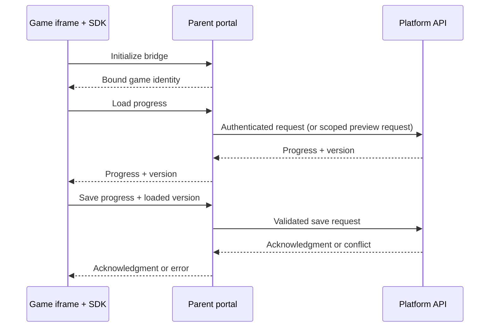

# Hippo Arcade Platform — Developer Reference · SDK v2

This reference describes the portal-bridge SDK. Games load the hosted SDK and communicate
with their parent portal. The portal handles API routing, player authentication and
token renewal. Games do not configure a server URL or receive player credentials.

## Environments

| Environment | Portal | Developer console | Purpose |
|---|---|---|---|
| **Test** | [golive-platform.netlify.app](https://golive-platform.netlify.app/) | [Test developer console](https://golive-platform.netlify.app/developer) | Upload and validate builds before production submission. |
| **Production** | [www.hippoarcade.com](https://www.hippoarcade.com/) | [Production developer console](https://www.hippoarcade.com/developer) | Production submissions and live player distribution. |

**The Netlify URL is the test environment, not production.** Check the host before
uploading or submitting a game. Do not assume that test uploads, approvals, accounts
or saved progress transfer to production.

The same game ZIP can use either environment without changing an API URL. The parent
portal selects the backend and binds requests to the game it launched. Test the ZIP
in the target environment; the bridge-enabled portal/API must be deployed there first.

## 1. Include the SDK in your game

### Hosted script (recommended)

Load the [hosted v2 SDK](https://www.hippoarcade.com/sdk/v2/platform-sdk.js)
before your game code. No SDK file is needed in your game ZIP:

```text
index.html
game.js
assets/
```

```html
<head>
  <script src="/sdk/v2/platform-sdk.js" defer></script>
  <script src="./game.js" defer></script>
</head>
```

The root-relative SDK URL loads from the environment serving your game, including
player, developer-preview and admin-preview launches. Do not hard-code the test
host in production games. Local portal development also proxies `/sdk/`.
The script exposes `window.Platform` and `window.HippoArcadeSDK` (SDK 2.1.0+).
`window.GoLiveSDK` remains a compatibility alias. Keep boot logic in
`game.js`; published-game CSP blocks inline JavaScript. Use relative game asset paths.

`/sdk/v2/platform-sdk.js` receives compatible v2 updates without a game rebuild
(after caches refresh, normally within one hour). Breaking changes require a new
major URL and an explicit game migration. For a fixed release, use
`/sdk/2.0.0/platform-sdk.js`; its contents never change. Hosted loading requires
network access when the SDK is not cached. These URLs require the updated platform
to be deployed before uploading games that use them.

### Bundled script (optional)

The kit uses hosted loading and does not include an SDK script. Developers who
choose to bundle it can obtain `platform-sdk.js` from the SDK package build output.
Load it using `./platform-sdk.js` and include it in the ZIP. Bundled copies receive
updates only after rebuilding and re-uploading the game.

### Bundler/package

If your build has the supplied `@gaming-platform/sdk` package configured:

```js
import Platform from '@gaming-platform/sdk';
```

Bundle that import into your game output. Do not assume the package is available
from a public registry; obtain the current package/source from the platform team.
The hosted script and package are generated from the same SDK source.

**Rebuild and re-upload games after migrating to v2.** Updating the portal does not
replace an old SDK already bundled inside a game ZIP.

## 2. Initialize, identify the player and load progress

Place this logic in your game's external boot script (or bundler entry point):

```js
async function bootGame() {
  await Platform.init({ clientVersion: '1.0.0' });
  const player = await Platform.getPlayer();
  const saved = await Platform.getGameProgress();

  // Use saved.progress, not the entire response envelope.
  const state = saved.version === 0
    ? { schemaVersion: 1, level: 1, score: 0 }
    : saved.progress;

  // Your game supplies these functions.
  showPlayerName(player.displayName);
  restoreGameState(state);
  await loadGameAssets();

  window.parent.postMessage(
    { type: 'GAME_READY' },
    new URL(window.location.href).origin,
  );
  showStartButton();
}

bootGame().catch(error => {
  // Do not convert a failed cloud load into an empty save.
  showConnectionError(error.message);
});
```

`initFromPortal()` is an alias for `init()`. Both must be awaited. Optional settings:

| Option | Meaning |
|---|---|
| `clientVersion` | Your game build version, included in telemetry. |
| `platform` | Telemetry platform label; defaults to `web`. |
| `timeoutMs` | Bridge request timeout; defaults to 15,000 ms. |

There is no `apiBaseUrl` or `gameId` initialization option. Local standalone pages
cannot connect to platform services and return `NOT_IN_IFRAME`. You may provide
practice mode without cloud writes; use the local portal or test developer console
for authenticated integration testing.

## 3. Save at checkpoints

```js
// Only after a successful getGameProgress(), including for a new player.
async function saveCheckpoint(state) {
  const saved = await Platform.saveGameProgress(state);
  showSaveStatus('Saved'); // Persistence acknowledged by the server.
  return saved.version;
}
```

- Save a JSON object no larger than **64 KB**, with at most six nesting levels.
- Include your own `schemaVersion` and migrate older save formats deliberately.
- Loads return `{ gameId, progress, version, updatedAt? }`. No existing save is
  represented by `progress: {}` and `version: 0`.
- Saves return `{ gameId, version, updatedAt }`. The SDK tracks the version and
  serializes progress operations; the backend atomically rejects stale writes.
- After any failed load or save, successfully load again before attempting a save.
  Reconcile the returned data with pending local progress. Never blindly overwrite
  a newer save after a conflict or uncertain timeout.
- Save during gameplay at meaningful checkpoints. An asynchronous save during
  tab close/unload is not a reliable persistence strategy.

Live save permissions are server-authoritative. Handle `ENTITLEMENT_RESTRICTION`
without discarding pending local progress. Do not hardcode subscription tiers,
favourite quotas or assumptions that all trial saves are forbidden.

## 4. Developer and admin previews

Developer test-play and admin review use the same bridge as player playback, with
**persistent isolated test profiles**. No separate player login is required.

A test save belongs to the combination of **reviewer role, reviewer ID and game ID**.
Closing and reopening a preview, renewing its preview link, or uploading a new build
of the same game keeps that reviewer's saved progress. Different reviewers, roles
and games have separate saves. Preview saves never modify real player progress.
This persistence is within the environment being used; do not expect test-site
saves to appear on the production site.

The preview profile has `authType: 'PREVIEW'`. Supported operations are initialization,
profile lookup, progress load/save and play/access checks. Telemetry is acknowledged
without entering production analytics. Other operations—including leaderboard,
economy, remote-config and feature-flag calls—currently return
`PREVIEW_UNSUPPORTED_OPERATION`.

```js
const player = await Platform.getPlayer();
if (player.authType !== 'PREVIEW') {
  await Platform.submitScore('high-score', score, { durationSeconds: 10 });
}
// Cloud-save calls work in both modes; preview saves use the isolated profile.
```

For live leaderboard/economy testing, use player playback in the **test environment**.
If the preview link expires, close and reopen the preview. Your test save remains.

## 5. SDK method reference

| Method | Result / behavior |
|---|---|
| `init(options?)` / `initFromPortal(options?)` | `Promise<void>`; establishes the portal bridge. |
| `getPlayer()` | `Promise<PlayerInfo>`; retrieves the profile or throws. |
| `currentPlayer()` | Cached `PlayerInfo` or `null`; synchronous. |
| `login()` | `Promise<{ status, player }>`; checks identity, never creates an account. Status is `ok`, `auth_required` or `session_unknown`. |
| `getGameProgress()` | Promise of the progress envelope described above. |
| `saveGameProgress(progress)` | Promise of the acknowledged save version/timestamp. |
| `getLeaderboard(name?, limit?)` | Promise of the leaderboard response, including `entries`; default name is `default`, limit 50. |
| `submitScore(name, score, metadata?)` | Submits to a console-created leaderboard in the current game. `submitScore(score, metadata?)` uses the default leaderboard. |
| `getMyRank(name?)` | Promise of the player's leaderboard score/rank response. |
| `getGameAccess()` / `authorizeAndPlay()` | Server-authoritative access check / play authorization. |
| `startSession()` | Returns a telemetry session ID synchronously and queues `game_started`; does not replace play authorization. |
| `currentSessionId()` | Current telemetry session ID or `null`. |
| `endSession(seconds?)` | Queues `game_ended` and attempts a best-effort telemetry flush. |
| `track(name, properties?)` | Queues telemetry; does not save game progress. |
| `flushEvents()` | Promise; flushes up to 50 queued events. Await before controlled navigation where practical. |
| `reportError(error, context?)` | Best-effort error reporting. |
| `getSubscription()` | Promise of server entitlements; not the old `SubInfo` wrapper. |
| `getProducts(country?)` | Promise of subscription products; does not purchase anything. |
| `getGems()`, `getDailyBonusStatus()`, `claimDailyBonus()` | Live wallet/bonus operations. |
| `getGames(filters?)`, `getRecentGames(limit?)`, `getMyGames()` | Live catalog/player-library operations. |
| `addFavourite()` / `removeFavourite()` | Favourite operations for the current game, subject to server rules. |
| `config.getAll()` / `config.get(key, fallback?)` | Live remote configuration. |
| `flags.getAll()` / `flags.isEnabled(key, fallback?)` | Live feature flags. |

The profile includes `id`, `username`, `displayName`, `authType`, and optional
`avatarUrl`. Do not treat a profile ID as authentication or expect access tokens.
Account registration, logout, upgrades, purchases and redemption belong in portal UI.
There are no SDK v2 token-handling methods, `payments.checkout`, or simulated ad-success helpers.

## 6. Errors and recovery

SDK request failures carry `error.status` and `error.code`.

| Code | Recovery |
|---|---|
| `NOT_IN_IFRAME` | Launch through the portal or preview. |
| `NOT_INITIALIZED` | Await `Platform.init()` first. |
| `PORTAL_TIMEOUT` | Connection/outcome is uncertain. Reconnect and reload progress before retrying saves. |
| `PROGRESS_NOT_LOADED` | Successfully load progress before saving. |
| `SAVE_CONFLICT` | Reload and reconcile against the newer cloud save. |
| `SESSION_CHANGED` | Player identity changed; reload the game. |
| `AUTH_REQUIRED` / `UNAUTHORIZED` | Sign in via the portal, or reopen an expired preview. |
| `ENTITLEMENT_RESTRICTION` | Explain the access restriction; retain unsaved progress for retry. |
| `PREVIEW_UNSUPPORTED_OPERATION` | Skip the capability in preview; test it through test-environment player playback. |
| `BRIDGE_LIMIT` | Too many pending/total bridge requests; reduce calls and reload if needed. |

Do not create a guest account, switch servers, or fall back to direct REST when the
bridge fails. Preserve pending local state and display a retry/reload message.

## 7. Bridge, engine exports and browser behavior



The SDK manages `GP_BRIDGE_REQUEST` / `GP_BRIDGE_RESULT`, request IDs and timeouts.
Do not implement credential messages yourself. The host verifies the sending iframe
and exposes fixed operations, not an arbitrary URL proxy. Trusted games use the shared same-origin iframe policy in player, developer and
admin surfaces. `allow-same-origin` enables origin-dependent browser storage and
Web Locks on HTTPS. Games share the portal origin and must be reviewed as trusted
portal code; this is not a security boundary against malicious games. Namespace
storage keys and lock names by game ID. Browser settings can still deny storage.
Preview and published games enforce the same CSP. The SDK API contract is unchanged:
the bridge still performs authenticated requests and scopes preview operations.

For browser compatibility, Web Locks (`navigator.locks.request`) may reject even
when `navigator.locks` exists. Cloud load/save must not depend on acquiring a
browser lock: serialize operations with an in-memory promise queue when locks
are unavailable or denied, and keep using the SDK progress version/conflict
handling across clients. Catch lock-acquisition failures separately from errors
inside the callback so a failed save is never executed twice. Rebuild and
re-upload game bundles after changing their persistence adapter.

Unity, Godot and other engine exports should call the JavaScript SDK through their
engine's JavaScript interop layer. They should not call the REST API directly or
request bearer tokens from the iframe host.

Send `GAME_READY` after assets and initial rendering are ready. `GAME_OVER` may be
sent as an optional completion notification; it does not save progress or submit a score.
Unlock audio in a user click/tap handler and pause gameplay/audio when appropriate
on tab visibility changes. Do not assume access to camera, microphone or payment APIs.

## 8. Leaderboards

Create an active leaderboard in the Developer Console before submitting scores.
The SDK uses the leaderboard's slug within the current game; it never creates a
leaderboard automatically or selects another game's leaderboard.

Scores must be finite and non-negative and respect any configured maximum.
Submissions have a 30-second per-player/per-leaderboard cooldown. Coalesce repeated
submissions and handle HTTP 429. The definition's metric determines whether higher
or lower scores are better; do not assume higher always wins.

## 9. Package, test and submit

1. Use the **test developer console** to register/manage your game and upload a ZIP.
2. Put `index.html` at the ZIP root, include the SDK and all required assets, and use
   relative paths. Keep the package under 200 MB.
3. Use external scripts/styles as required by game CSP. Do not ship executable/server
   files such as `.exe`, `.dll`, `.php`, `.py` or shell scripts.
4. Test initialization, first save, close/reopen persistence, errors, responsive layout
   and audio in developer preview. Test live-only capabilities in test player playback.
5. Upload the verified ZIP through the **production developer console** when ready
   for production review. A test submission is not a production submission.

### Submission checklist

- [ ] Correct environment selected; Netlify is test, Hippo Arcade is production.
- [ ] Current SDK v2 bundled; no API URLs, token logic or direct REST fallbacks.
- [ ] `await Platform.init()` and `await Platform.getPlayer()` complete before platform use.
- [ ] Successful progress load precedes every save sequence; restore `saved.progress`.
- [ ] Save payload stays within 64 KB and uses a game-defined schema version.
- [ ] “Saved” appears only after the save promise resolves.
- [ ] Preview saves survive closing/reopening; unsupported preview features are skipped.
- [ ] Leaderboard exists, score limits are respected and throttling is handled.
- [ ] `GAME_READY` follows asset readiness; audio starts from a user gesture.
- [ ] ZIP root, relative assets, game metadata, orientation and artwork are verified.

## Migrating a v1 game

Replace URL/game-ID initialization with `await Platform.init()`, and token handoff
with `await Platform.getPlayer()`. Remove token storage/refresh, direct REST calls,
and obsolete payment/ad helpers. Update progress handling to use the response envelope
and load-before-save discipline. Rebuild the entire game ZIP with SDK v2 and upload it.
There is no intermediate direct-network compatibility mode.

See [SDK Reference](SDK_REFERENCE.md) for the platform build commands and migration
prerequisites. This document describes the v2 integration contract; it does not imply
that a particular test or production deployment has already been upgraded.

*Developer Reference · SDK v2 · October 2026*
